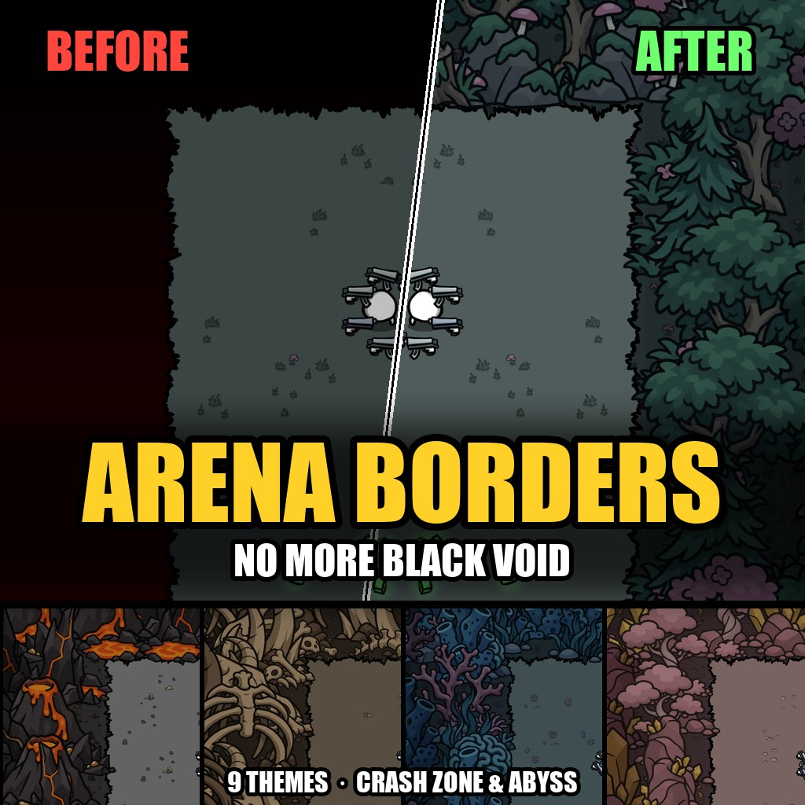
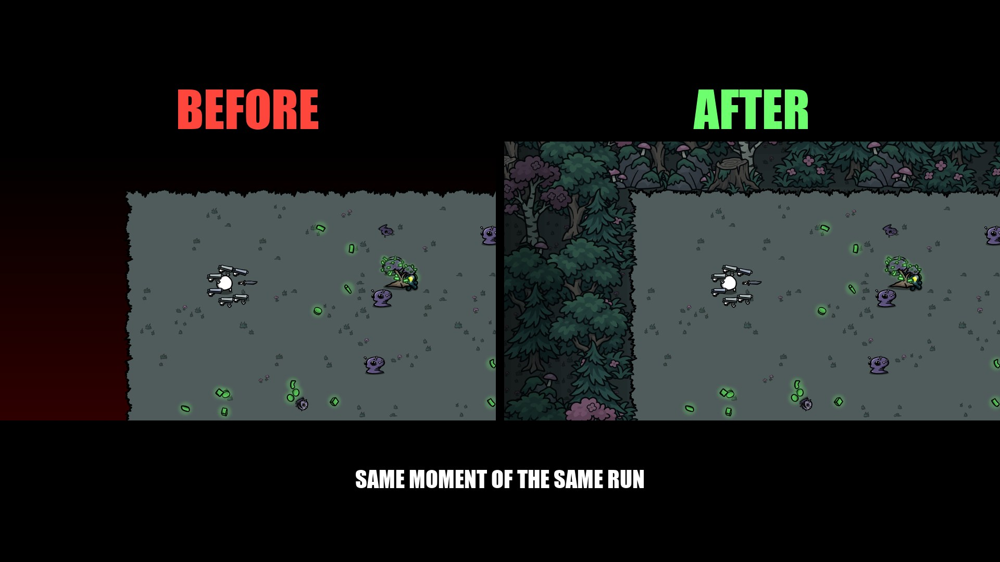
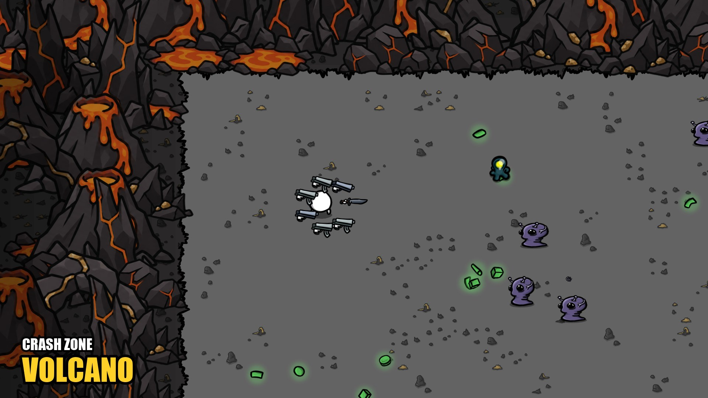
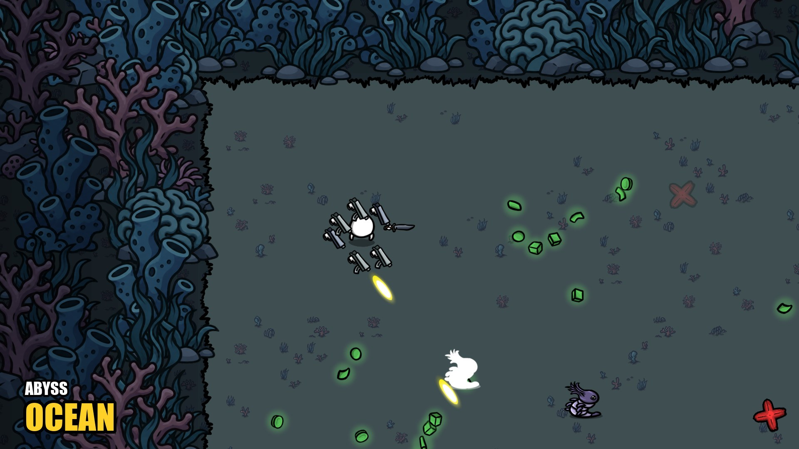

# Arena Borders (Brotato mod)

The jungle arena from Primal Dread has trees, rocks and plants around it. The Crash Zone and the Abyss have nothing: just a black void past the edge. This mod fills that void, so every arena feels like a real place.

**Steam Workshop:** https://steamcommunity.com/sharedfiles/filedetails/?id=3838781019

## What it does

- The ground continues past the arena edge, in shadow, getting darker with distance.
- Themed props stand around the arena in layers: low ones at the edge, tall ones behind them, dark far layers for depth.
- Each of the nine backgrounds has its own set that matches its ground.
- Visual only: no collisions, no gameplay changes, nothing is saved in your run.
- Props stay outside the arena and do not cover your character.
- Works in local co-op: the surroundings reach the screen edges when the camera zooms out.
- No dependencies. Game version 1.2.0.2, Mod Loader 6.3.0.

| Crash Zone | Abyss |
|---|---|
| Dirt: cacti, sandstone spires, a dead tree | Ocean: corals, kelp, tube sponges |
| Forest: oak, fir, a blossoming tree, stumps | Shipwreck: a mast, an anchor, a ship bow, a chest |
| Volcano: basalt spires, small volcanoes, gold veins | Abyss: giant shells, starfish, sea urchins |
| Dreamy Lands: yellow crystals, pink rocks | |
| Boneyard: ribcages, a horned skull, tusks | |
| Darklands: dead trees, blue mushrooms | |

## Install

- **Steam:** subscribe on the Workshop page.
- **Manually:** zip the `mods-unpacked` folder (the zip must contain `mods-unpacked/kosneu-ArenaBorders/...`) and put it into the game's `mods` folder.

## How it works

`mod_main.gd` waits for the wave scene, then places sprites from `borders/<theme>/` around `ZoneService.get_current_zone_rect()` for the current background (`RunData.get_background()`), each sprite measured from its own edge so it never enters the arena. `outer_ground.gd` draws darkened tiles of the same background past the arena outline. The jungle backgrounds already have their own surroundings and are left alone.

## Bugs and compatibility

Found a bug or a conflict with another mod? Open an issue here or write in the Workshop comments: which background, what you saw, which other mods you use. A screenshot helps a lot.

---

## По-русски

Мод добавляет окружение вокруг арены в первой локации и в Бездне вместо чёрной пустоты: земля продолжается за край, вокруг стоят предметы по теме каждого из девяти фонов. Только внешний вид, на игру не влияет, зависимостей нет. Работает и в локальной совместной игре.

Установка: подписаться в мастерской Steam или положить zip с папкой `mods-unpacked` в папку `mods` игры. О багах и несовместимостях пишите в Issues или в комментариях мастерской.
